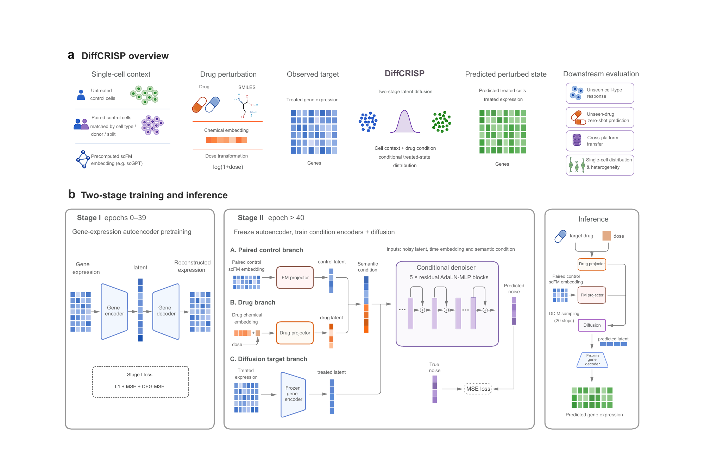

<div align="center">

# DiffCRISP

### Distribution-aware single-cell drug perturbation prediction with conditional latent diffusion

[](https://www.python.org/)
[](https://pytorch.org/)
[](#datasets-and-inputs)
[](expdata/README.md)

**[Overview](#overview)** · **[Highlights](#highlights)** · **[Getting started](#getting-started)** · **[Reproducing figures](#reproducing-the-paper)** · **[Citation](#citation)

</div>

---

## Overview

**DiffCRISP** is a conditional latent diffusion framework for **single-cell drug perturbation prediction**. It combines information from matched untreated cells (represented by a single-cell foundation model), drug molecular features, and dosage to generate *populations* of plausible post-treatment gene-expression profiles.

Unlike methods focused primarily on the mean drug response, DiffCRISP is designed to evaluate the **distribution of predicted cellular responses**, including heterogeneity and reference-defined responding fractions.

<div align="center">
  
  <p><em>Figure 1. Overview of DiffCRISP and its two-stage training and inference pipeline.</em></p>
</div>

## Highlights

| | Key idea | Implementation |
|:---:|---|---|
| **01** | **Biologically informed conditions** | Matched-control scFM embeddings together with drug molecular features and `log1p(dose)` form the conditional representation. |
| **02** | **Conditional latent generation** | A gene-expression autoencoder first learns a compact latent space; a conditional diffusion model then generates treated-cell latents, decoded into expression profiles. |
| **03** | **Distribution-aware evaluation** | Analyses include unseen cell types and drugs, distributional fidelity, drug-responsive subpopulations, and cross-platform transfer. |

The repository also includes **deterministic** and **fixed-variance Gaussian** latent generators for controlled comparisons with diffusion. These baselines are not additional components of the main diffusion generator.

## Method at a glance

**Stage I — expression representation (epochs 0–39).** Train a gene-expression encoder and decoder using L1, MSE, and a DEG-focused reconstruction term.

**Stage II — conditional generation (from epoch 40).** Freeze the expression autoencoder. For the diffusion variant, learn a denoising network conditioned on cell-context and drug–dose representations. Generate latent samples with DDIM and decode them into post-treatment expression profiles.

| Main setting | Value |
|---|---|
| Expression latent size | 128 (source default; check run overrides) |
| Conditional representation | 256 dimensions (cell + drug branches) |
| Diffusion backbone | 5 residual AdaLN-style MLP blocks |
| Forward diffusion | 1,000 timesteps |
| Main inference path | 20 DDIM steps |
| DMSO guidance | Reference drug index and dose read from the loaded dataset |
| Gaussian ablation | Fixed sampling standard deviation `σ = 0.1` |

> **Reproducibility note.** The source defaults above describe the current implementation, not every historical checkpoint or sensitivity experiment. Processed data, pretrained checkpoints, and a verified end-to-end reproduction pipeline are **not all provided in this repository**. Always use the original run configuration when reproducing a reported result.

## Repository layout

```text
CRISP-diffusion/
├── DIFFCRISP/
│   ├── model.py                     # Main model and generator selection
│   ├── ConditionalDiffusion.py      # Latent diffusion / DDIM
│   ├── DeterministicPredictor.py    # Deterministic baseline
│   ├── GaussianPredictor.py         # Fixed-variance Gaussian baseline
│   ├── data.py                      # Data and matched-control handling
│   ├── trainer.py                   # Training and checkpoint management
│   ├── train.py                     # Single-run training
│   ├── test.py                      # Checkpoint evaluation
│   └── ...
├── experiments/configs/
│   ├── nips.yaml
│   └── sci.yaml
├── expdata/
│   ├── README.md                    # Figure 1–10 reproduction guide
│   ├── fig1/overview.png            # Figure 1 for this README
│   └── fig1/ ... fig10/             # Figure-specific materials
├── requirement.txt
├── setup.py
├── LICENSE.txt
└── README.md
```

## Getting started

### 1. Install the environment

```bash
git clone https://github.com/windy-hy/CRISP-diffusion.git
cd CRISP-diffusion

conda create -n diffcrisp python=3.9
conda activate diffcrisp

pip install -r requirement.txt
pip install -e .
```

A CUDA-enabled environment is recommended. Some current training/evaluation paths use CUDA-specific tensor placement.

### 2. Prepare the data

The code expects **processed AnnData (`.h5ad`)** files, predefined split labels, **scFM embeddings**, and **drug molecular embeddings (`.parquet`)**. Raw dataset downloads are not automatically converted into these inputs.

| Benchmark | Example local AnnData path | Configuration |
|---|---|---|
| NeurIPS chemical perturbations | `data/nips/nips_pp_scFM_resplit.h5ad` | [`nips.yaml`](experiments/configs/nips.yaml) |
| SciPlex3 | `data/sciplex3/sciplex3_pp_hvgenes_scFM_resplit.h5ad` | [`sci.yaml`](experiments/configs/sci.yaml) |

Typical molecular-feature paths are `data/drug_embeddings/fcfp4_1024_embedding_lincs_nips.parquet` and `data/drug_embeddings/fcfp4_1024_embedding_lincs_sciplex3.parquet`. These are local filenames, **not download links**. The selected `--FM_key` must match the actual `adata.obsm` key in the processed dataset.

### 3. Train a model

Run from the `DIFFCRISP/` folder so that the relative file paths resolve correctly:

```bash
cd DIFFCRISP

python train.py \
  --config ../experiments/configs/nips.yaml \
  --split split \
  --seed 0 \
  --savedir ../model/nips/example/split/seed0 \
  --FM_key X_scGPT \
  --drug_emb ../data/drug_embeddings/fcfp4_1024_embedding_lincs_nips.parquet \
  --data_path ../data/nips/nips_pp_scFM_resplit.h5ad \
  --mmd_co 0.0
```

The main comparison uses training seeds **`0`, `42`, and `123`** across the relevant three splits. The batch launcher `run_all.py` is experiment-specific; inspect and adjust its dataset/split/path settings before use.

**Loss implementation:** the Stage-I objective in the supplied model is `0.5 × L1 + 0.5 × MSE + 0.2 × AFMSE`. The historical `--mmd_co` CLI argument does **not** enable MMD in the current optimized loss.

### 4. Evaluate a checkpoint

```bash
python test.py \
  --config ../experiments/configs/nips.yaml \
  --split split \
  --seed 0 \
  --FM_key X_scGPT \
  --data_path ../data/nips/nips_pp_scFM_resplit.h5ad \
  --model_dir ../model/nips/example/split/seed0
```

This is a **single-checkpoint-directory evaluation example**, not a one-command reproduction of every paper figure. It requires the corresponding processed data and saved weights.

## Reproducing the paper

The experimental materials are organized to match the **10 figures in the current manuscript**. For figure descriptions, expected inputs, measurement definitions, and available plotting materials, see **[the figure reproduction guide](expdata/README.md)**.

| Figure | Topic | Figure | Topic |
|---|---|---|---|
| [Fig. 1](expdata/fig1/) | Architecture and training | [Fig. 6](expdata/fig6/) | Molecular/component ablations |
| [Fig. 2](expdata/fig2/) | Unseen-cell-type benchmarks | [Fig. 7](expdata/fig7/) | Unseen-drug / joint zero-shot |
| [Fig. 3](expdata/fig3/) | Generator comparisons | [Fig. 8](expdata/fig8/) | Cross-platform transfer |
| [Fig. 4](expdata/fig4/) | Distribution recovery | [Fig. 9](expdata/fig9/) | Pathway-based prioritization |
| [Fig. 5](expdata/fig5/) | Responding subpopulations | [Fig. 10](expdata/fig10/) | Hyperparameter sensitivity |

Please retain each experiment's split, seed, feature key, resolved model parameters, reference condition, checkpoint, and evaluation settings. The figure folders may include plotting scripts, intermediate tables, and figure exports; **not every figure is currently documented as executable end-to-end from raw data**.

<details>
<summary><strong>Current implementation notes</strong></summary>

- DMSO reference indexing is obtained from the dataset's drug mapping; the model requires a uniquely identifiable DMSO drug–dose condition.
- `GENERATOR_TYPE` in `DIFFCRISP/model.py` switches among `diffusion`, `deterministic`, and `gaussian`. Use the corresponding trained checkpoint.
- Model defaults can be overridden by explicit `hparams` or saved checkpoint settings.
- The present `test_all.py` launcher passes a `--ddim` argument not accepted by the inspected `test.py` CLI. Use `test.py` directly until this mismatch is resolved.
- `model/` and raw or processed inputs may be absent from the public repository and are not needed merely to browse the source.

</details>

## Citation

The DiffCRISP manuscript citation will be added when bibliographic details are publicly available. This implementation builds upon the original **CRISP** framework:

> *Predicting drug responses of unseen cell types through transfer learning with foundation models.* **Nature Computational Science**. [DOI: 10.1038/s43588-025-00887-6](https://doi.org/10.1038/s43588-025-00887-6)

## Acknowledgments & license

This repository builds on ideas and code from the [CRISP project](https://github.com/ml4bio/CRISP). Please respect the licenses of the upstream project, datasets, and pretrained representations. See [`LICENSE.txt`](LICENSE.txt) for the license included here.
